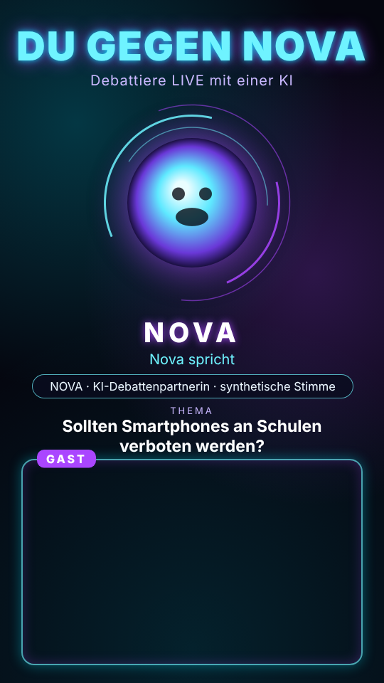

# NOVA live auf TikTok: Einrichtung mit „TikTok LIVE verbinden“ (ab 0.5.0)

```text
TikTok-Gast → LIVE Studio (Ausgabe: Voicemeeter Input) → Banana VAIO → A1 (Kopfhörer) + B2 → DEBATE AI → OpenAI Realtime
TikTok-Gast ← LIVE-Stream ← LIVE Studio (Mikrofon: Voicemeeter Out B1) ← B1 ← Banana AUX ← DEBATE AI (NOVA)
                                                   Dein Mikrofon (Hardware-Eingang 1) → B1
```

**DEBATE AI verbindet sich nicht selbst mit TikTok.** Es nutzt die Windows-Audiogeräte, aus denen LIVE Studio aufnimmt und auf die es ausgibt. Die App zeigt deshalb nie „mit TikTok verbunden“ an, sondern prüft jedes Glied der Audiokette auf deinem PC.

## Einmalig vorbereiten

1. **Voicemeeter Banana** von [vb-audio.com](https://vb-audio.com/Voicemeeter/banana.htm) installieren (ersetzt Voicemeeter Standard) und **Windows neu starten**.
2. Voicemeeter Banana starten.
3. In **TikTok LIVE Studio**, Einstellungen → Audio:
   - **Mikrofon:** `Voicemeeter Out B1` (genau eine Mikrofonquelle, kein zusätzliches Desktop-Audio).
   - **Lautsprecher / Audiogerät:** `Voicemeeter Input`.

## In DEBATE AI: „TikTok LIVE verbinden“

| Schritt | Was passiert | Wer |
|---|---|---|
| 1 · Voicemeeter Banana | Erkennt Installation und Typ (Standard reicht nicht), startet Banana auf Knopfdruck | automatisch |
| 2 · Routing in Voicemeeter | Stellt über die offizielle Voicemeeter-Fernsteuerung ein: Gast-Ton (VAIO) → A1 + B2, nicht B1 · NOVA (AUX) → B1 (+ A1 zum Mithören), nicht B2 · dein Mikrofon → B1 · A1 = Borofone-Kopfhörer · Hardware-Eingang 1 = Mikrofonarray. Zeigt vorher alle Änderungen, ändert nur diese Schalter und liest sie zurück | automatisch nach deiner Bestätigung |
| 3 · DEBATE-AI-Geräte | Eingang `Voicemeeter Out B2`, Ausgang `Voicemeeter AUX Input` | automatisch |
| 4 · Routing-Messung | Spielt Testsignale auf den Gast-Weg und den NOVA-Weg und misst, ob sie genau auf B2 bzw. B1 ankommen und nicht zurücklaufen | automatisch (du hörst Testsignale) |
| 5 · OpenAI | Öffnet eine Realtime-Sitzung und misst die Aufbauzeit | automatisch |
| 6 · LIVE Studio | Erkennt, ob LIVE Studio läuft; Mikrofon- und Ausgabewahl bestätigst du | du |
| 7 · Gastton | 15 s lang: Gast spricht oder Ton läuft in LIVE Studio → Pegel an VAIO (über Voicemeeter) und B2 (DEBATE AI) | du lässt Ton laufen, Messung automatisch |
| 8 · NOVA | Zeigt Persönlichkeit, Position und Kostenlimit | Anzeige |
| 9 · Einwilligung | Gäste informiert, KI-Hinweis im Stream eingeblendet | du |

**Startfreigabe** gibt es erst, wenn 3, 4, 5, 6, 7 und 9 bestanden sind. Dann startet „Live-Debatte starten“ NOVA mit dem TikTok-Profil (OpenAI-Satzende, Geduld ausgewogen, kurze Antworten, NOVA stoppt bei Unterbrechung, Vollduplex ab dem ersten Wort, weil die Messung kein Echo gezeigt hat).

## Wenn LIVE Studio den Gast nicht getrennt ausgibt

Der Gastton-Test (Schritt 7) zeigt das ehrlich: Kommt bei VAIO nichts an oder hörst du dort auch dich selbst und den Stream, gibt LIVE Studio den Gast nicht getrennt aus. **Unterstützte Alternative:** Den Gast über eine Anruf-App (z. B. Discord, Zoom) zuschalten, deren **Lautsprecher** `Voicemeeter Input` und deren **Mikrofon** `Voicemeeter Out B1` ist. In LIVE Studio bleibt `Voicemeeter Out B1` das Mikrofon; damit das Publikum den Gast hört, in LIVE Studio zusätzlich `Voicemeeter Out B2` als zweite Audioquelle hinzufügen. In Schritt 6 „Stattdessen: Gast über eine Anruf-App“ ankreuzen.

## Szene „DEBATE AI – NOVA LIVE“ (Overlay, ab 0.7.0)

DEBATE AI liefert die Live-Szene selbst aus, nur auf deinem PC (`127.0.0.1`), ohne Internet und ohne TikTok-Zugangsdaten.



1. DEBATE AI starten → „3 · Gesprächssteuerung“ → **Stream-Overlay (Link kopieren)**. Der Link lautet normalerweise `http://127.0.0.1:18190/nova`.
2. TikTok LIVE Studio → neue **vertikale** Szene „DEBATE AI – NOVA LIVE“ → Quelle hinzufügen → **Link** → Link einfügen → Größe **1080 × 1920**.
3. Die Link-Quelle **ganz nach unten** legen. Kamera (oder Gast-Fenster) darüber in den Rahmen „GAST“ ziehen.
4. Alternative ohne Hintergrund: `http://127.0.0.1:18190/nova?view=badge` ist durchsichtig und zeigt nur Titel, KI-Hinweis und Sprechanzeige über der Kamera.

Die Szene zeigt: „DU GEGEN NOVA“, den dauerhaften Hinweis „NOVA · KI-Debattenpartnerin · synthetische Stimme“, das Debattenthema aus DEBATE AI und eine NOVA-Figur, deren Mund und Leuchten **NOVAs echter Ausgabelautstärke** folgen (keine Lippensynchronisation). Status: spricht / denkt nach / hört zu.

Bekannte Grenzen (laut Anbietern anderer Overlays): Die Link-Quelle von LIVE Studio nutzt einen älteren eingebauten Browser, der manchmal einfriert oder die Quelle winzig darstellt. Abhilfe: in den Quelleneigenschaften `?x=1` an den Link anhängen (lädt neu) oder die Quelle löschen und neu hinzufügen. Das Overlay ist deshalb bewusst schlicht programmiert. **In deiner LIVE-Studio-Version ungetestet.**

## Live-Titel und Beschreibung (zum Einfügen)

- Titel: **Traust du dich gegen eine KI? 🤖 | Debattiere LIVE mit NOVA**
- Beschreibung: *Diskutiere live mit NOVA, unserer künstlichen Intelligenz. Du vertrittst deine Meinung, NOVA antwortet mit eigenen Argumenten. Traust du dich?*
- Gäste: Mehrgast-/Gast-Anfragen in LIVE Studio erlauben. Profil, Benutzername und Kontoeinstellungen bleiben unverändert.

## Kosten beim ersten Test

Unter „3 · Gesprächssteuerung“: **Kostenlimit** auf z. B. **0,50 $** stellen und **„Bei Kostenlimit OpenAI-Sitzung ganz beenden“** angehakt lassen (Standard). Beim Erreichen schließt DEBATE AI die OpenAI-Verbindung vollständig; es entstehen danach keine weiteren Kosten. Die Kosten sind eine Schätzung aus den von OpenAI gemeldeten Tokens; maßgeblich ist die Abrechnung im OpenAI-Konto. Für reine Audiotests den Modus „Offline-Probe“ oder „Lokal“ verwenden (kostenlos).

## Während der Live-Debatte

Die Kontrollzeile im Hauptfenster zeigt: ● Eingang (Gastton kommt an) · ● NOVA-Ausgang · ● OpenAI · ● Gast spricht · Echo-Warnung · geschätzte Kosten. Darüber: Latenz der letzten Antwort, Durchschnitt und p95.

Knöpfe: Debatte starten · Pause · NOVA soll sprechen / Jetzt antworten · NOVA unterbrechen · NOVA stumm · **Gast ausreden lassen** (an/aus, wirkt sofort) · Ruhe in der Debatte · **Not-Aus (Esc)**.

**Kostenlimit:** Standard 5 $ pro Debatte. Ist es erreicht, schaltet sich NOVA stumm und hört nur noch zu.

## Kennzeichnung und Einwilligung

- NOVA sagt beim Start hörbar, dass sie eine KI ist.
- Blende im Stream dauerhaft „NOVA · KI-Debattenpartnerin · synthetische Stimme“ ein und nutze die KI-Kennzeichnung von TikTok, falls angeboten.
- Informiere Gäste vor dem Zuschalten, dass ihre Beiträge an OpenAI gehen. DEBATE AI zeichnet keine Gespräche auf; die Mitschrift bleibt im Arbeitsspeicher.
